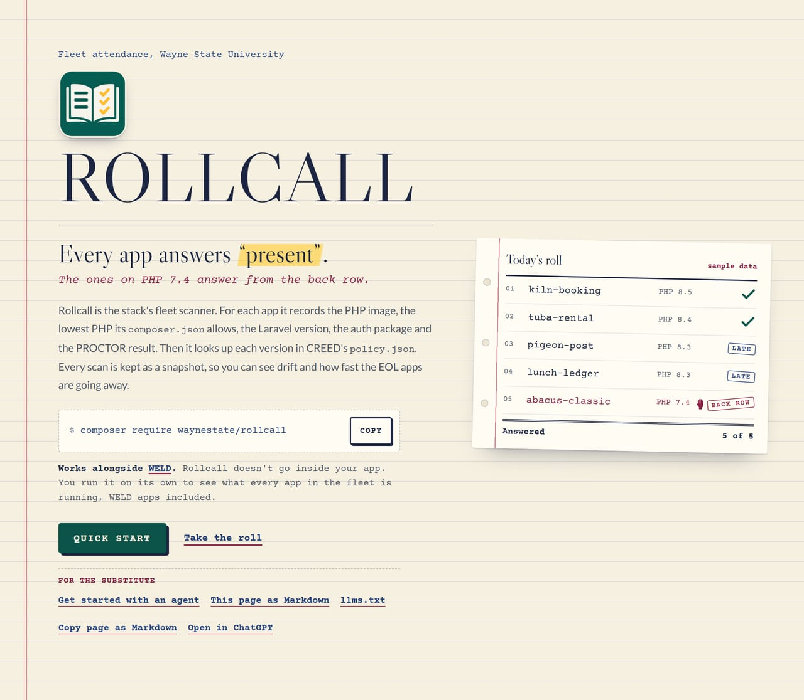
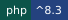
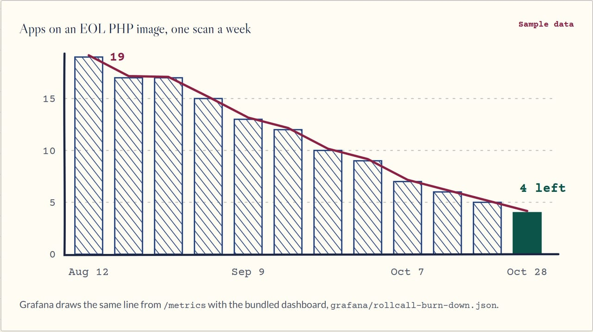
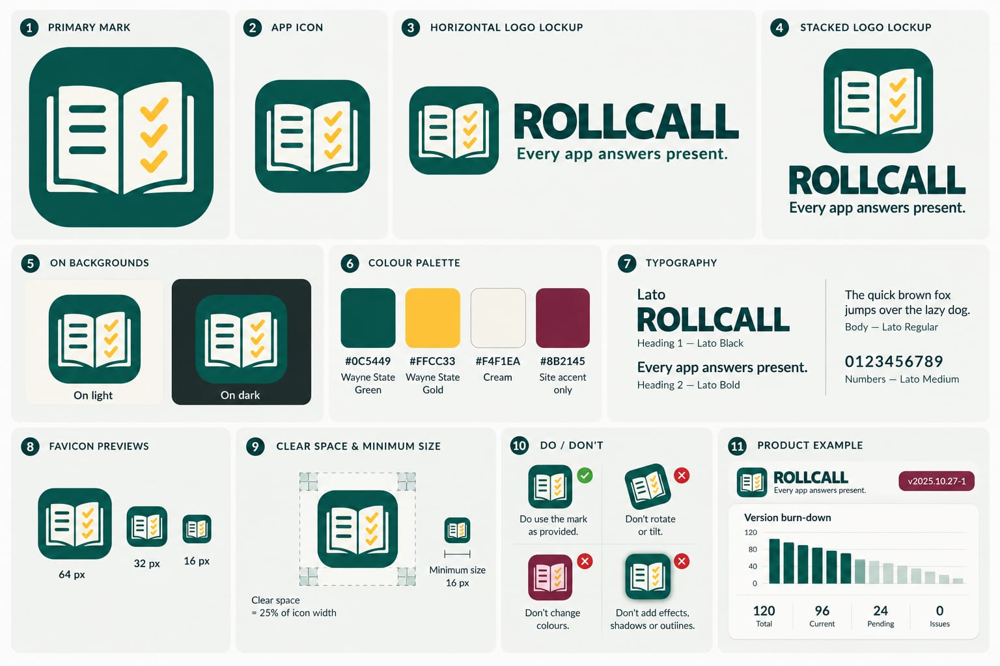

<div align="center">
  <a href="site/index.html"></a>
</div>

# Rollcall

<p>
  
  
  
  <a href="https://github.com/waynestate/rollcall/actions/workflows/ci.yml"></a>
</p>

Checks: `composer ci` (the same command runs on GitLab and GitHub).

> Every app answers "present". The ones on PHP 7.4 answer from the back row.

Front page: [`site/index.html`](site/index.html). It is static, with no build step (see `site/README.md`).
On Citadel, the raw-PHP deploy layer in [`deploy/`](deploy/) serves it: a Squire kit whose front controller puts `site/` behind HELMET's security headers. For local development, serve `site/` directly.

Rollcall is the fleet scanner for the Wayne State application stack. For each app it records the PHP image, the
lowest PHP its `composer.json` allows, the Laravel version, the auth package and its version, the PROCTOR result,
and, when the app commits one, the result, Booster version and finish time of Booster's hop record
(`booster-hop.json`). Then it looks up each version by date in CREED's `policy.json`. It keeps one snapshot per
scan, so you can see drift and an EOL burn-down over time. It prunes old snapshots after the retention window
(default 90 days; the newest one always stays).

Rollcall enforces nothing. It never opens an issue, leaves a comment or deploys anything, and it exits `0` whatever
the fleet looks like. The public report has totals only: counts and progress, no app names, owners or rankings. The
per-app list is internal. Like a good attendance sheet, it is for noticing who is missing, not for shaming them.

<div align="center">
  
  <br><sub>One page of the roll book, called name by name. Sample data: the apps are fictional, and a real scan's per-app list stays internal.</sub>
</div>

## Where it sits in the stack

The parts of the Wayne State application stack, and their jobs. WELD is the Laravel starter app that has most of them installed:

| Part | Job |
|---|---|
| WayneUI (project 0) | The interface layer: tokens, components, four consumer paths |
| CREED | The standards and `policy.json`, the dates Rollcall reads |
| PROCTOR | Measures one app against the policy; Rollcall reads its JSON report and never re-runs a rule |
| Preflight | CI templates |
| SESAME | Protocol-neutral auth; Rollcall reports which auth package each app uses |
| HELMET | Baseline runtime and its own optional `/metrics` |
| Pinstripe | The coding standard this repo includes for its Pint and PHPStan settings |
| Sourdough | Starters |
| Rollcall | The fleet census and EOL burn-down |

## How it is built

A framework-free core (`src/`) plus thin entry points that hold no rules:

- `bin/rollcall`: the CLI (`scan`, `report`, `digest`, `drift`, `advisories`, `prune`). One PHP command, so it works the same on Windows, macOS and Linux.
- `public/index.php`: a raw-PHP front controller for `GET /metrics` and `GET /report.json`.
- `rollcall_dashboard()`: the dashboard page for a raw PHP app, one call in a file you serve (see "The dashboard in a raw PHP app").
- `src/Laravel/`: a Laravel adapter with a dashboard page (the Blade view, or an Inertia page in your own layout), a `/metrics` route and `php artisan rollcall:scan` and `rollcall:prune`.
- `resources/js/RollcallDashboard.vue`: the same dashboard as a Vue component, for an Inertia app's own page (see "The dashboard in an Inertia app (Vue)").

The Blade view and `rollcall_dashboard()` print the same renderer (`src/Dashboard/DashboardPage.php`) from the same
report, so they cannot drift, and CI fails the Vue component on any difference from that renderer's markup.

CREED's policy reader lives under `src/Creed/` (namespace `Waynestate\Rollcall\Creed`) as a generated copy, made
by CREED's `bin/export.php`. CREED is on Packagist now, so the copy can become a `require` of `waynestate/creed`;
until Rollcall switches, the copy stays. To refresh it, run
`php <creed>/bin/export.php --namespace='Waynestate\Rollcall\Creed' --to=src/Creed` from a CREED checkout.
`composer creed-copy:check` proves the copy has not drifted (it reads the checkout from `CREED_PATH`); a hand edit
to `src/Creed/` fails that check.

Weekly CREED copy refresh: a scheduled GitLab job (`creed-copy-refresh`, Mondays, an hour after CREED's policy
robot) re-exports the copy from CREED main, rebuilds the versions table and docs, runs `composer creed-copy:check`
and `composer ci`, and pushes to main only when both pass. A red run leaves main untouched. Details in
MAINTAINING.md, "Refreshing the CREED copy".

Data comes in through three interfaces. Each has a fixture adapter, so you can try everything without a live host:

| Source | Interface | Adapters |
|---|---|---|
| Repositories (`composer.json`, `composer.lock`, `booster-hop.json`) | `RepositorySource` | a directory of fixtures; GitLab over PSR-18, tested against recorded responses |
| Runtime image per app | `ImageSource` | a JSON export of the app list from any platform, or Citadel's own registrations export (which adds forced upgrade dates) |
| PROCTOR result | `ProctorReportSource` | a directory of PROCTOR `--format=json` reports (the default); or, with `ROLLCALL_PROCTOR_SOURCE=gitlab`, each project's proctor job artifact in GitLab CI (see [docs/architecture.md](docs/architecture.md#where-proctor-results-come-from)) |

Rollcall only reads from every source. It writes its own snapshot directory, and digest files only when
`rollcall digest --out` asks for them.

The decisions behind this shape (saved files over live calls, counts in public, one image source, the contract) are
recorded in [DECISIONS.md](DECISIONS.md) and [ADR/](ADR/).

## Install

```
composer require waynestate/rollcall
```

Rollcall 1.0.0 is on Packagist. No extra repository needed. Requires PHP `^8.3`. The CLI is `vendor/bin/rollcall`.

From 1.0 Rollcall follows SemVer against its contract ([`contract/`](contract/README.md)): inside 1.x the report,
the stored snapshot and the image list may gain a field (a minor release) but never lose or retype one. Promoted
to 1.0 with perfect attendance.

## Quick start

This runs on the fixtures in the repo, so you need no network and no token. Run `composer install` once
(or the Docker line under "Run the checks"), then the commands below.

Linux and macOS (bash):

```
export ROLLCALL_POLICY_FILE=tests/fixtures/policy.json
export ROLLCALL_REPOS_DIR=tests/fixtures/repos
export ROLLCALL_IMAGES_FILE=tests/fixtures/images.json
export ROLLCALL_PROCTOR_DIR=tests/fixtures/proctor
export ROLLCALL_STORE_DIR=var/snapshots
php bin/rollcall scan
php bin/rollcall report
```

Windows (PowerShell, no bash or WSL needed):

```
$env:ROLLCALL_POLICY_FILE = "tests/fixtures/policy.json"
$env:ROLLCALL_REPOS_DIR = "tests/fixtures/repos"
$env:ROLLCALL_IMAGES_FILE = "tests/fixtures/images.json"
$env:ROLLCALL_PROCTOR_DIR = "tests/fixtures/proctor"
$env:ROLLCALL_STORE_DIR = "var/snapshots"
php bin/rollcall scan
php bin/rollcall report
```

`policy.json` is CREED's file; the copy under `tests/fixtures/` is a snapshot for tests. Use the released one in real
runs.

## Commands

```
rollcall scan       [--today=YYYY-MM-DD] [--prune[=DAYS]]
rollcall report     [--format=text|json|prometheus] [--internal] [--today=YYYY-MM-DD]
rollcall digest     [--owner=CONTACT] [--format=text|json] [--out=DIR] [--send] [--today=YYYY-MM-DD]
rollcall owners     [--format=text|json]
rollcall drift      --feed=<file> [--component=php] [--today=YYYY-MM-DD]
rollcall advisories --feed=<file> [--today=YYYY-MM-DD]
rollcall prune      [--days=N] [--dry-run] [--today=YYYY-MM-DD]
```

- `scan` scans once and stores `<ROLLCALL_STORE_DIR>/<date>.json`. A second scan on the same day replaces it. A
   gap in one source (a missing report, a bad image tag) becomes a note on that app, and the scan carries on. A
   refused GitLab token stops the scan loudly instead of producing a flattering partial answer.
  `--prune[=DAYS]` deletes snapshots older than that many days after saving (default: `ROLLCALL_RETENTION_DAYS`,
  90; 0 keeps everything).
- `report` prints the latest snapshot against the policy as of today. `text` is a terminal table, `json` is the
  machine-readable form, `prometheus` is the metrics text (refused unless `ROLLCALL_METRICS_ENABLED=true`).
  `--internal` adds the per-app list; keep that output inside the project.
- `digest` builds the opt-in owner digests (see "Owner digests" below): plain words about only one owner's apps,
  only when something changed since the previous scan. It prints them; `--out=DIR` writes one text file each;
  `--send` mails them, and only when sending is switched on too.
- `owners` reads the same owners file as `digest`, checks it against the latest scan, and names every scanned app
  whose owner is unknown: no entry lists it, or no entry that lists it was confirmed (its `"confirmed"` date) in
  the last `ROLLCALL_OWNERS_CONFIRM_DAYS` days (365 by default). It exits 1 when there is one, and the weekly scan
  job runs it, so a new app without an owner, or an owner nobody has re-confirmed in a year, fails that job.
- `drift` compares `policy.json` with a saved endoflife.date v1 product page (for example
  `https://endoflife.date/api/v1/products/php/` saved to a file). A difference is a flag for a person to look at; the
   policy stays the source of truth. Rollcall does not fetch that page itself.
- `advisories` checks each app's locked `laravel/framework` and auth-package versions against a saved Packagist
  security-advisories response (for example
  `https://packagist.org/api/security-advisories/?packages[]=laravel/framework` saved to a file). One line per
  package and version, sorted by package then version: the status (`affected`, `clear` or `no data`), the count and
  the advisory ids, and how many apps hold that pair. A package with no advisory data prints `no data`, never
  `safe`: an absent row proves nothing about the package, and a version nobody can parse says `no data` too.
     Rollcall does not fetch that page itself; a person saves it and `--feed` points at the file. Output is package
  names and counts only: no app ids.
- `prune` deletes snapshots older than `--days` (default: `ROLLCALL_RETENTION_DAYS`, 90; 0 keeps everything). The
  newest snapshot is never deleted, even if it is older than the cut-off, so the dashboard always has data.
  `--dry-run` lists what would go without deleting anything.

Exit codes: `0` ok, `2` tool error (bad option, unreadable policy, a source that refused). There is no `1`: Rollcall
does not gate anything.

### Which command when

<!-- which-command-when: canonical copy in WELD docs/reference/which-command.md; edit there first, then copy word for word -->
Several stack commands sound alike (`weld:doctor`, `squire doctor`, `proctor check`) and do different jobs. Find your question in the second column and run the command beside it. The doctors look at setup, the proctor grades against policy, and the gate decides deploys: same waiting room, different appointments.

| Command | What it checks | When to run it | Where it runs |
|---|---|---|---|
| `composer ci` | **Will my pipeline pass?** The repo's own CI contract, the same command the pipeline runs: validation, the tests, Pint, PHPStan, `composer audit` and whatever checks the repo adds. | Before every push. | App repo, CI |
| `bin/weld.sh doctor` or `.\bin\weld.ps1 doctor` (both run `php artisan weld:doctor`) | **Does my WELD app hold together?** The app key, writable `storage` and `bootstrap/cache`, the database connection and pending migrations. One PASS, WARN or FAIL line each; exit 1 on a FAIL. Standards are PROCTOR's. | After `up`, when the app will not start, and after every deploy off Citadel. | App repo (in the app container), deploy host (in the app container) |
| `vendor/bin/squire doctor` | **Is my Citadel release setup right?** `build.sh`, the release scripts, the health check, script hygiene, line endings, secrets kept out of git and the local parity setup, against Squire's rules. Exit 1 on a failed rule. The lock file, audit and MySQL 5.6 checks are handed to PROCTOR. | After `squire init` or `squire update`, and before the first deploy. | App repo, CI |
| `vendor/bin/squire init --check` | **Have the files Squire wrote drifted from its templates?** Missing, outdated or edited copies. Writes nothing; exit 1 on drift. | After you upgrade Squire (then run `squire update`), and in CI. | App repo, CI |
| `vendor/bin/squire doctor oracle`, or `php artisan oracle:check` in WELD and Sourdough's Laravel apps | **Can my app reach Oracle?** The `ORACLE_*` settings, the host, the port, the `oci8` driver and the login, in plain language, printing setting names and never values. Silent when the app has no Oracle settings. | After you fill in the `ORACLE_*` settings, or when a connection fails. Squire's `release.sh` runs the same check on every release, as a report. | App repo, deploy host |
| `vendor/bin/proctor check` (`composer proctor` in WELD and Sourdough's apps) | **Does my app meet CREED's policy?** The PHP floor, Laravel, Node and MySQL end of life, the committed lock, `composer audit`, open-ended constraints, portability, MySQL 5.6 safety, overrides and the rest of its checks. Exit 1 on a FAIL. | Before you merge; the pipeline runs it too. | App repo, CI |
| `vendor/bin/proctor gate` | **May this commit deploy?** The deploy-time subset of `proctor check`, ratcheted against the last release's verdict, so a deploy that makes nothing worse goes. Exit 1 is a no-go. | At deploy time. Squire's `release.sh` calls it for you. | Deploy host |
| `sourdough manifest --check` | **Which managed files did I change since Sourdough baked my app?** Managed files that changed or are missing against `.sourdough/manifest.json`; seeded files are yours and never reported. Exit 1 on a change. | Before `sourdough feed`. | App repo, CI |
| `sourdough feed --dry-run` | **Is my app behind its Sourdough template?** The plan a feed would apply, with nothing written. Exit 1 when feeding would change files. | After you install a new Sourdough, and in CI to catch an app falling behind. | App repo, CI |
| `booster plan` | **What does my upgrade take?** The ordered PHP, Laravel and front-end hops, the dependencies that block them, and advisory PHPCompatibility and PHPStan scans. Changes nothing. | Before an upgrade, and when PROCTOR says your PHP or Laravel is past support. | App repo |
| `booster replay check` | **Does my app still answer the same after a change?** Replays the requests in `booster-replay.json` and compares the answers with the ones `booster replay record` saved. Exit 1 on a changed answer. | After an upgrade hop or a hand fix, once you have a recording. | App repo (in Docker) |
| `booster init --check` | **Are Booster's coding-tab playbooks current?** The playbooks in `.agents/skills`. Changes nothing; exit 1 when one is missing or out of date. | After you upgrade Booster, and in CI. | App repo, CI |
| `php bin/regen-check.php --generated <dir>` | **Is WELD still Sourdough's Inertia shape?** WELD, file by file, against a fresh `sourdough new --inertia`; fails only on drift that `.sourdough/regen-baseline.json` does not already accept. | When Sourdough's Inertia shape or WELD changes. | WELD repo, CI |
| `rollcall report` | **Where does the whole fleet stand?** The latest scan's totals against CREED's policy: PHP, Laravel, the auth package, PROCTOR results and the end-of-life burn-down. Always exit 0; it never gates. | After `rollcall scan`, on the scan's schedule. | CI (a scheduled scan job) |
<!-- /which-command-when -->

The canonical copy of this table is in WELD's docs: [Which command when](https://weld.apps.wayne.edu/docs/reference/which-command.html).

## What the report says

- **Apps present and scan notes**: the apps the scan read, then the notes it printed and carried on past
  (`totals.scan_errors` in JSON). Today a note means a source is not configured (no image export, no PROCTOR
  reports). A note is not a failed scan: a source that refuses stops the scan instead.
- **PHP image, declared PHP floor, Laravel**: apps per version, the state from the policy (`active`, `security_only`,
  `eol`, `unknown`), the date security support ends and the days left (negative once past).
- **Auth package and PROCTOR**: apps per auth package, and per PROCTOR result (`pass`, `fail`, `none`).
- **Drift**, counted per kind: `image_eol`, `image_unknown`, `image_below_floor`, `floor_allows_eol`,
  `floor_unbounded`, `eol_past_grace` (past the policy's grace days), `laravel_eol`, `proctor_missing`,
  `proctor_failing`, `override_expired`.
- **Progress**: apps that moved since the previous scan and apps that went from an EOL image to a supported one. In
  the internal view each upgraded app carries the day it landed.
- **EOL burn-down**: for each scan day, how many apps ran an EOL image on that day. It reads the image, not the
  declared floor, so it stays `unknown` until an image export is configured. Each day also carries the same roll
  three ways, counts only: per support state (`states`), per PHP minor of the image (`php_image`, such as
  `{"8.1": 3, "8.4": 9}`) and per Laravel major (`laravel`). Every stored snapshot gets the breakdown, including the
  ones written before it existed, so the history reaches back as far as `rollcall prune` keeps snapshots.

- **Forced image upgrades**: with Citadel's export as the image source, how many apps have a forced base-image
  upgrade pending, how many are due today or earlier, and the next date (`forced_upgrades`). The same counts reach
  `/metrics` (`rollcall_forced_upgrades_pending_apps`, `rollcall_forced_upgrades_overdue_apps` and
  `rollcall_forced_upgrades_next_due_timestamp_seconds`) and ADVISOR's `rollcall_fleet_summary`. The internal
  per-app list carries each app's `upgrade_due`. Zero with any other image source. See
  [docs/guides/citadel.md](docs/guides/citadel.md).

State is never decided in code: it is derived from the dates in `policy.json` by CREED's reader. A version the
policy does not list is `unknown`.

## Configuration

Every setting is an environment variable. `.env.example` holds placeholders; never commit a real token.

| Variable | Meaning | Default |
|---|---|---|
| `ROLLCALL_POLICY_FILE` | Path to CREED's `policy.json` | none (required for `report`, `drift`) |
| `ROLLCALL_STORE_DIR` | Snapshot directory, the only place Rollcall writes | `var/snapshots` |
| `ROLLCALL_SOURCE` | `directory` (fixtures) or `gitlab` | `directory` |
| `ROLLCALL_REPOS_DIR` | Fixture repositories as `<group>/<project>/composer.{json,lock}` | none |
| `ROLLCALL_GITLAB_URL` | `https://` base URL of the GitLab instance | none |
| `ROLLCALL_GITLAB_TOKEN` | A GitLab group or project access token (a bot), or a service account's token, with the read_api scope only, the Reporter role and an expiry. The stack's is the group token rollcall-scanner, rotated by the stack maintainer (docs/security.md). Never in git, never logged, never printed | none |
| `ROLLCALL_GITLAB_GROUPS` | Comma-separated group ids or paths; subgroups are included. Ignored when ROLLCALL_GITLAB_PROJECTS is set | none |
| `ROLLCALL_GITLAB_PROJECTS` | Comma-separated full `group/project` paths; when set, only those projects are scanned and no group is listed | none |
| `ROLLCALL_IMAGES_FILE` | Export of the app list: `{"apps": [{"project": "group/project", "image": "php:8.4-apache"}]}` | none |
| `ROLLCALL_CITADEL_EXPORT` | Citadel's saved registrations export, used instead of `ROLLCALL_IMAGES_FILE` (not both): base images plus forced upgrade dates. See [docs/guides/citadel.md](docs/guides/citadel.md) | none |
| `ROLLCALL_PROCTOR_SOURCE` | Where PROCTOR reports come from: `directory` (`ROLLCALL_PROCTOR_DIR`) or `gitlab` (each project's proctor job artifact from its newest finished default-branch pipeline, with the same `read_api` token and GitLab settings) | `directory` |
| `ROLLCALL_PROCTOR_DIR` | PROCTOR JSON reports, one per app: `group/project` is read from `group__project.json`. Not read when `ROLLCALL_PROCTOR_SOURCE` is `gitlab` | none |
| `ROLLCALL_PROCTOR_JOB` | `ROLLCALL_PROCTOR_SOURCE=gitlab`: the CI job whose artifact holds the report; set it when Preflight's proctor component is included with another `job_name` | `proctor` |
| `ROLLCALL_PROCTOR_ARTIFACT` | `ROLLCALL_PROCTOR_SOURCE=gitlab`: the PROCTOR `--format=json` report's path inside that job's artifact | `proctor.json` |
| `ROLLCALL_AUTH_PACKAGES` | Comma-separated Composer packages that count as an auth package. An entry without a slash matches that package under any vendor (`wayne-cas` matches `anyvendor/wayne-cas`); an entry with a slash matches exactly. First match in list order wins | `waynestate/sesame`, `waynestate/wayne-cas`, `apereo/phpcas`, `jasig/phpcas`, `subfission/cas`, `wayne-cas`, `simplecas` |
| `ROLLCALL_RETENTION_DAYS` | How many days of snapshots to keep; the newest is never deleted | `90` (0 keeps everything) |
| `ROLLCALL_OWNERS_FILE` | Owners file for the digests: `{"owners": [{"contact": "team@example.test", "digest": true, "projects": ["group/project"]}]}`. Rollcall's own, for the stack's projects, is `owners.json` in the repo (roles only); keep another fleet's outside a public repo | none (no digests) |
| `ROLLCALL_OWNERS_CONFIRM_DAYS` | How long an owners-file entry's `"confirmed"` date counts; past it, `rollcall owners` calls that owner unknown and exits 1 | `365` (0 turns the check off) |
| `ROLLCALL_DIGEST_MAIL_ENABLED` | Allow `rollcall digest --send` to mail | `false` |
| `ROLLCALL_DIGEST_MAIL_DSN` | Symfony Mailer DSN for sending, such as `smtp://mail.example.test:25`. A secret: never in git, never printed | none |
| `ROLLCALL_DIGEST_MAIL_FROM` | The from address of the digests | none |
| `ROLLCALL_METRICS_ENABLED` | Turn metrics on (`CLI report --format=prometheus` and `/metrics`) | `false` |
| `ROLLCALL_METRICS_TOKEN` | Bearer token a scraper must present | none |
| `ROLLCALL_METRICS_ALLOW` | Comma-separated scraper IP addresses (exact match) | none |
| `ROLLCALL_PUBLIC_REPORT_ENABLED` | Serve `GET /report.json` (public counts only) | `false` |
| `ROLLCALL_DASHBOARD_ENABLED` | Laravel and raw PHP: serve the dashboard page | `false` |
| `ROLLCALL_DASHBOARD_PATH` | Laravel: dashboard URL path | `rollcall` |
| `ROLLCALL_INTERNAL_ENABLED` | Laravel and raw PHP: serve the per-app page (Laravel at `<path>/apps`, behind your sign-in middleware; raw PHP only where you call `rollcall_dashboard(['internal' => true])` behind your sign-in) | `false` |
| `ROLLCALL_DASHBOARD_INERTIA` | Laravel + Inertia: answer the dashboard routes with the app's Vue page (`Rollcall/Dashboard`, published with `vendor:publish --tag=rollcall-inertia`) instead of the Blade view; same switches, same report. Needs `inertiajs/inertia-laravel` | `false` |
| `ROLLCALL_WAYNEUI_CSS` | Laravel and raw PHP: `https://` or absolute URL of WayneUI's stylesheet for the dashboard | none |

To scan GitLab you need the token and either a group or the project allowlist. The narrow way is
`ROLLCALL_GITLAB_PROJECTS`: name the exact `group/project` paths and Rollcall reads only those, never listing a
group. Otherwise set `ROLLCALL_GITLAB_GROUPS`. The token is a GitLab bot or personal access token with `read_api`
only and an expiry, whose user can read only the projects to scan; until it exists Rollcall runs on its fixtures.
Set `ROLLCALL_SOURCE=gitlab` and the GitLab variables. The `rollcall-scan` job in `.gitlab-ci.yml` does this on a
schedule or by hand (see below). Rollcall sends only `GET` and `HEAD`, fetches the two Composer files without
cloning, skips a file whose blob id has not changed, follows `Link` pagination only to the configured host, and
waits out `429 Retry-After`.

### Run the collector in Docker

No PHP on the machine? The repo ships a `Dockerfile` that builds a small image of the collector. It runs as a
non-root user, writes only to its snapshot folder, and takes every setting from the environment at run time.
Never put a token in the image: the build stays clean, and the token travels with `-e` (or `--env-file`) each
time you run. Two lines, and every app answers present.

Build it, from the repo root (again whenever the code changes):

```
docker build -t rollcall-collector .
```

That reads the `Dockerfile` next to it and tags the result `rollcall-collector`. Then run a scan. Each `-e`
flag is a setting from the table above; for the narrow scan add
`-e ROLLCALL_GITLAB_PROJECTS=group/project,other-group/other-project` and only those projects are read, no group
is listed. The two `-v` flags mount your policy file and snapshot folder so the answer survives the container:

```
docker run --rm -e ROLLCALL_SOURCE=gitlab -e ROLLCALL_GITLAB_URL=https://gitlab.example.test -e ROLLCALL_GITLAB_TOKEN="$ROLLCALL_GITLAB_TOKEN" -e ROLLCALL_GITLAB_GROUPS=your-group -e ROLLCALL_POLICY_FILE=/app/policy.json -v "$PWD/policy.json:/app/policy.json" -v "$PWD/var:/app/var" rollcall-collector scan
```

Next: after a good scan, `var/snapshots/<today>.json` holds the day's attendance, and the same run with
`report` instead of `scan` prints it. On Windows PowerShell, set `$env:ROLLCALL_GITLAB_TOKEN` first and use
`${PWD}` for the mount paths.

### Scheduled scan on GitLab CI

Rollcall's own repository (on git.wayne.edu, its canonical home) carries a `rollcall-scan` job in `.gitlab-ci.yml`. It
runs `scan` over the 13 stack projects read-only and keeps the snapshot in `var/snapshots/` as a 30 day artifact.
It runs when a GitLab schedule says so, or when a person starts it by hand from the web; without a token it skips
green. It needs three things in GitLab, and on git.wayne.edu all three exist:

1. A token with the `read_api` scope only, the Reporter role and an expiry. The stack's is the group access token
   `rollcall-scanner` on the `enterprise-apps` group, which expires 2027-11-06 (Rollcall prints a note 14 days
   before).
2. A CI/CD variable `ROLLCALL_GITLAB_TOKEN` on the ROLLCALL project: masked and hidden, protected (the schedule
   runs on the protected default branch), and not a file.
3. A schedule on `main`: CI/CD > Schedules, weekly (Monday), with the variable `ROLLCALL_JOB` set to `scan`.

The token is rotated by a role, the stack maintainer, not a named person. The runbook (where the token lives, when
it expires, the five steps, and what to look for in the job log) is "The scanner token and how to rotate it" in
[docs/security.md](docs/security.md).

About reach: a group token reads every project in its group. The project owner chose group reach for the stack's
token; the allowlist `ROLLCALL_GITLAB_PROJECTS` keeps what Rollcall asks for to the 13 projects (it never lists the
group and never asks for another project). If your fleet needs a tighter fence, give a service account Reporter on
just the projects to scan and use its token instead, because only membership limits what a token can read.

Exactly which scope, and why each other scope stays off: `read_api` covers all five calls Rollcall makes (listed
one by one, with the role and the expiry rules, under "The GitLab token, exactly" in
[docs/security.md](docs/security.md)). Not `api`, not `read_repository` (Rollcall never clones), not `read_user`,
not `self_rotate` (the stack maintainer rotates the token, never Rollcall).

## Owner digests (opt-in)

An owner who asks can get a short digest of only their own apps: what changed since the previous scan (an image
upgrade, a new drift flag, one cleared, a PROCTOR result that moved), then where each app stands. Nothing changed,
no digest. Nobody gets one by default, and no owner is ever guessed from commit authors.

1. Point `ROLLCALL_OWNERS_FILE` at an owners file that maps each scanned project to its contacts (a mail address,
   a team alias or a role). An owner opts in with `"digest": true`; leaving the key out means no. `"confirmed"` is
   the day the contact last said it still answers for those apps; `rollcall owners` calls the owner unknown once
   that day is older than `ROLLCALL_OWNERS_CONFIRM_DAYS`. The shape is `contract/owners.schema.json`.

   ```json
   {
       "$schema": "contract/owners.schema.json",
       "owners": [
           {"contact": "team@example.test", "digest": true, "confirmed": "2026-11-01", "projects": ["group/project", "group/other-project"]}
       ]
   }
   ```

   Rollcall keeps its own in the repo: [owners.json](owners.json) lists the 13 stack projects the scheduled scan
   reads, all answered for by the stack maintainer. The repo is public, so it names roles and teams, never a person.
   For another fleet, keep that fleet's file next to its snapshots, outside a public repo.
2. After a scan, `rollcall digest` prints each digest with news (`--format=json` for a script, `--owner=CONTACT`
   for one owner). `--out=DIR` writes them as `<date>-<contact>.txt` instead, for a mail tool you already have.
   A scanned app that no entry lists is never dropped: every run names it on stderr as "no owner on file", and the
   JSON lists it under `no_owner_on_file`.
3. To have Rollcall mail them itself, install `symfony/mailer`, set `ROLLCALL_DIGEST_MAIL_ENABLED=true`,
   `ROLLCALL_DIGEST_MAIL_DSN` and `ROLLCALL_DIGEST_MAIL_FROM`, and run `rollcall digest --send`. Without all four, it
   sends nothing. Every contact must be a mail address, or nothing goes out at all.

A digest names apps, so it is internal like the per-app list. It uses the report's own states and drift flags, so a
digest and the report never disagree. Schedule it after `rollcall scan` (weekly suits the burn-down).

## WSU values (Playbook)

`ROLLCALL_GITLAB_URL` is a Wayne State value, so it may come from Playbook (`waynestate/playbook`) when the
environment has none. The environment always wins; Playbook only fills what the environment leaves out. The GitLab
token never comes through Playbook and stays an environment variable.

| Setting | Value |
|---|---|
| `ROLLCALL_GITLAB_URL` | The `https://` base URL of the GitLab instance |

Playbook is private and lives on git.wayne.edu. Getting it into your app:

Composer: add the repository to your `composer.json`, then require the package. Composer authenticates to
git.wayne.edu with the token in `auth.json`.

```json
{
    "repositories": [
        {"type": "vcs", "url": "https://git.wayne.edu/enterprise-apps/playbook.git"}
    ]
}
```

```
composer require waynestate/playbook
```

curl (Linux, macOS):

```
curl --fail -H "PRIVATE-TOKEN: $GITLAB_TOKEN" "https://git.wayne.edu/api/v4/projects/enterprise-apps%2Fplaybook/repository/files/playbook.env/raw?ref=main" -o .env.playbook
```

PowerShell (Windows):

```
Invoke-WebRequest -Headers @{ 'PRIVATE-TOKEN' = $env:GITLAB_TOKEN } -Uri "https://git.wayne.edu/api/v4/projects/enterprise-apps%2Fplaybook/repository/files/playbook.env/raw?ref=main" -OutFile .env.playbook
```

Clone:

```
git clone https://git.wayne.edu/enterprise-apps/playbook.git
```

The token is your own: `read_api` for curl, `read_repository` for clone and Composer.

Playbook is private on git.wayne.edu. If you get a 404, ask the Enterprise Applications team for read access.

## Metrics

Metrics are off by default (the stack's metrics rule). With `ROLLCALL_METRICS_ENABLED=true`, `/metrics` serves
Prometheus text built from the latest snapshot (a request never triggers a scan). It needs `ROLLCALL_METRICS_TOKEN` as a bearer token or an address in
`ROLLCALL_METRICS_ALLOW`; with neither set, nobody gets in. Labels are version numbers, state names, drift kinds and
public package names: no app names or personal data. The dashboard JSON is in `grafana/rollcall-burn-down.json`; import
it into Grafana once a Prometheus server scrapes the endpoint. Run `rollcall scan`
on a schedule so the series moves.

Forced image upgrades from a Citadel export come through as three gauges, counts only, in the same style as the
rest: `rollcall_forced_upgrades_pending_apps` (apps with one pending, overdue ones included),
`rollcall_forced_upgrades_overdue_apps` (due today or earlier) and
`rollcall_forced_upgrades_next_due_timestamp_seconds` (midnight of the next date still ahead, only while there is
one). With any other image source the two counts are 0 and the date is absent. The dashboard shows pending and
overdue as two stat panels.

## Laravel

The package registers itself (`extra.laravel.providers`). Publish the config with
`php artisan vendor:publish --tag=rollcall-config`, set the variables above, and schedule `rollcall:scan`. The
dashboard shows counts and progress; the per-app page is a second route that stays off until you enable it, and it
runs behind `rollcall.dashboard.internal_middleware` (default `web` and `auth.sesame`), so an app with no such
middleware fails closed. The page uses WayneUI's class names and takes its stylesheet from `ROLLCALL_WAYNEUI_CSS`.
In an Inertia app it can be one of your own Vue pages instead: see "The dashboard in an Inertia app (Vue)".
The `/metrics` route is registered on its own path; if your app already serves `/metrics` (HELMET does), run Rollcall's
on a separate app or leave metrics off.

## The dashboard in a raw PHP app

The same page, no framework. `rollcall_dashboard()` prints the renderer the Laravel page prints, from the same
report, so the two answer the roll in the same words. Drop one file into the folder your web server serves:

```php
<?php
// public/rollcall.php
require __DIR__ . '/../vendor/autoload.php';

$helmet = \Waynestate\Helmet\helmet_boot(['preset' => 'citadel']);
rollcall_dashboard(['nonce' => $helmet['nonce']]);
```

It answers 404 until `ROLLCALL_DASHBOARD_ENABLED=true`, sends `X-Robots-Tag: noindex` with every answer, and never
runs a scan: it reads the latest snapshot, so set `ROLLCALL_POLICY_FILE` and `ROLLCALL_STORE_DIR` as for the CLI
and schedule `vendor/bin/rollcall scan`. The page has no script. Its one small style element takes HELMET's nonce;
link WayneUI's stylesheet with `ROLLCALL_WAYNEUI_CSS` and the page keeps its look under HELMET's CSP even without
one. No HELMET? Call `rollcall_dashboard()` with no options.

The per-app page is a second file, behind your sign-in: call `rollcall_dashboard(['internal' => true])` after
SESAME's `sesame_login()` has returned a user. It also needs `ROLLCALL_INTERNAL_ENABLED=true`; with either one
missing it answers 404, so it fails closed. For a front controller of your own,
`Waynestate\Rollcall\Dashboard\RawDashboard::response()` returns the same answer as data (status, headers, body).

## The dashboard in an Inertia app (Vue)

In a Laravel + Inertia + Vue app (WELD's shape) the dashboard can be one of the app's own pages, inside its own
layout. Same routes, same switches, same report: with `ROLLCALL_DASHBOARD_INERTIA=true` the controller hands what
`DashboardPage::report()` built to an Inertia page as props (`report`, `internal`, `scanCommand`) instead of printing
the Blade view. From a WELD app:

```bash
php artisan vendor:publish --tag=rollcall-inertia   # writes resources/js/pages/Rollcall/Dashboard.vue
# .env: ROLLCALL_DASHBOARD_ENABLED=true and ROLLCALL_DASHBOARD_INERTIA=true
npm run build
```

The published page is short and it is yours. In essence it puts the component in WELD's `AppLayout` with a title
and a `noindex` tag (the full file adds breadcrumbs and a few lines of scoped CSS, in WayneUI's spacing tokens, that space the sections and set the three totals side by side):

```vue
<script setup lang="ts">
import AppLayout from '@/layouts/AppLayout.vue';
import { Head } from '@inertiajs/vue3';
import RollcallDashboard from '../../../../vendor/waynestate/rollcall/resources/js/RollcallDashboard.vue';

defineProps<{ report: Record<string, unknown> | null; internal: boolean; scanCommand: string }>();
</script>

<template>
    <Head title="Rollcall"><meta name="robots" content="noindex" /></Head>
    <AppLayout>
        <RollcallDashboard :report="report" :internal="internal" :scan-command="scanCommand" />
    </AppLayout>
</template>
```

Why this shape: the page is published because the layout is the app's, and the component is imported straight
from `vendor/` because the markup is Rollcall's. `composer update` moves the component together with the PHP
renderer it must match, and there is no npm package to install or keep in step (Rollcall publishes none). Vite and
`vue-tsc` follow the relative import like any file in the project, and the component imports nothing but `vue`,
which the app already has. An app that does not use the Vue page loads none of it; `inertiajs/inertia-laravel` is
needed only when the switch is on.

The component renders what the Blade page shows inside `<main>`: the same WayneUI classes, the `role="status"` line,
the captions and headers, and the per-app table only on the internal page (`<path>/apps`, still behind
`rollcall.dashboard.internal_middleware` and `ROLLCALL_INTERNAL_ENABLED`). It has no style block, no style attribute
and no script of its own, so it works under HELMET's CSP, and it takes its look from the app's WayneUI stylesheet.
Every Inertia answer carries `X-Robots-Tag: noindex`. CI holds the rooms together: `dashboard-vue` server-renders
the component with the props the route sends and fails on any difference from the Blade page (elements, attributes
and text; only whitespace, attribute order and Vue's hydration comments are normalized), and `dashboard-a11y`
checks the three Vue pages with the other six.
## Use Rollcall from your coding agent (ADVISOR)

Rollcall ships a module for [ADVISOR](https://packagist.org/packages/waynestate/advisor), the stack's MCP server: three
read-only tools, and a small creed goes with them: every app answers present, the agent may ask, and nobody gets ranked.

Install both packages where the MCP server runs:

```
composer require waynestate/advisor waynestate/rollcall
```

Then name the module in your own manifest file. Rollcall ships none on purpose, so nothing loads by accident:

```json
{
    "modules": [
        "Waynestate\\Rollcall\\Advisor\\RollcallModule"
    ]
}
```

and point `ADVISOR_MODULES_FILE` at that file. The tools read the snapshot store behind `ROLLCALL_STORE_DIR`; with an
empty store each one says so in plain words and names `rollcall scan`.

| Tool | What it answers |
|---|---|
| `rollcall_fleet_summary` | Counts from the latest snapshot: apps by PHP image, declared floor, Laravel line, auth package and PROCTOR result, drift per kind, progress since the previous scan, forced image upgrades (`forced_upgrades`: pending, overdue, next due), and the snapshot date |
| `rollcall_burn_down` | The dated EOL series, one point per scan day, each with its counts per support state, PHP minor and Laravel major; optional `days` (an integer, 1 to 365) keeps only the most recent days |
| `rollcall_supported_versions` | Every version in CREED's policy, grouped by what it says today: active, security only, or end of life |

The tools take no path, command or URL, make no network call, and answer public counts only: the same fields
`/report.json` serves. The per-app list stays internal and never leaves through a tool. Each answer names its source
and its dates.

## Proof

Rollcall's first scheduled scan of the stack on GitLab CI and a rerun over 58 Wayne State applications
(2026-11-06): what ran, what held, what it caught in Rollcall and what it does not prove yet, on the
[Proof](docs/reference/proof.md) docs page.

## Docs

The full documentation lives at [/docs/](/docs/) on the project site: install, guides, reference and checks, built
from `docs/` by Squire's docs builder. Two tables are generated so they cannot drift: the command reference comes
from `php bin/rollcall list --format=json`, and the environment table is scanned out of `src/`, `bin/` and
`config/`.

- `composer docs` rebuilds `site/docs/` from `docs/`; run it after editing a page.
- `composer docs:check` fails when the built site is stale or a generated table has drifted; `composer ci` runs it.

The pages are committed because the deploy server serves `site/` without building. Every page links back to its
Markdown, and the footer stamps the version the docs describe. Roll call: the docs answer present too.

The docs pages wear the front page's look: the same masthead and menu, ruled paper, Caslon titles, the front
page's red section folios (each section of a page opens with its own "§ 1") and the green back cover. To change it, edit `docs/_header.html` (the masthead, links written as if from `site/`) and
`docs/theme/rollcall.css` (the front page's tokens mapped onto the kit's `--dk-*`, plus a derived dark mode), then
run `composer docs`. Never edit `site/assets/docs.css` or `docs.js`: they are Squire's kit and a sync overwrites them.

## Run the checks

Maintainers: how to build, test and release this project, and where its data comes from, is in [MAINTAINING.md](MAINTAINING.md).
Why it is built this way is in [DECISIONS.md](DECISIONS.md) and the ADRs under [ADR/](ADR/).

`composer ci` runs every check: manifest, tests (the contract suite among them), Pint, PHPStan, `composer audit`, a
check that the front page versions table still matches CREED's policy, and a check that the docs site is current.
The contract itself is JSON Schema in [`contract/`](contract/README.md): the report, the stored snapshot and the
image list export. `tests/ContractTest.php` runs the real commands on the fixtures and validates their output
against it, so a field cannot appear or vanish without the contract changing in the same commit. PHP is not needed on the host:

```
docker run --rm -v "${PWD}:/app" -w /app composer:2.10.3 sh -c "composer install --no-interaction && composer ci"
```

(On Windows PowerShell `${PWD}` works as written; in Git Bash use `$(pwd -W)` and set `MSYS_NO_PATHCONV=1`.)

The GitLab pipeline (`.gitlab-ci.yml`) and the GitHub workflow (`.github/workflows/ci.yml`) both wrap `composer ci`,
on PHP 8.3, 8.4 and 8.5. git.wayne.edu now has an instance runner, and the stack's CI runs on it. Every product in
the stack still strongly recommends a git.wayne.edu instance runner, so that capacity stays there.

The front page has its own accessibility gate (axe-core in Playwright, run in Docker): `scripts/a11y.sh` on Linux
and macOS, `scripts/a11y.ps1` on Windows; MAINTAINING.md says when to run it.

## Security notes

- Read-only toward GitLab and everything else: one gate in the GitLab adapter allows only `GET` and `HEAD`, and a test
  fails if a write verb appears in `src/`.
- The GitLab token is a group or project access token (a GitLab bot), or a service account's token, with the
  `read_api` scope only, the Reporter role and an expiry; the stack's is the group access token `rollcall-scanner`,
  which expires 2027-11-06. It goes in the environment as `ROLLCALL_GITLAB_TOKEN`, never in git, is sent only to the
  configured `https` host, and is hidden from debug output and error messages. `ROLLCALL_GITLAB_PROJECTS` limits
  what Rollcall asks for, not what the token can read; only the token's membership does that. When the source is
  GitLab, `scan` reads the token's own record (`GET /api/v4/personal_access_tokens/self`) and prints a note 14 days
  before it expires, or when it has already expired. The note names the date; the stack maintainer (a role, not a
  named person) rotates the token before its expiry, never Rollcall, following the runbook in
  [docs/security.md](docs/security.md). The check is advisory: a refused, unreachable or unparseable answer prints
  nothing and never fails the scan, and the token value never appears in output.
- Composer files are parsed as data. No `composer install`, script or plugin from a scanned repository ever runs.
- PROCTOR reports, image tags and app ids are outside input: shapes are validated, text is bounded, and terminal output
  strips control characters.
- Every GitLab call, the scope that covers it, and the scopes the token must not have are tabled in
  [docs/security.md](docs/security.md); a test fails if the adapter calls a path that table does not list.

<details>
<summary>Watch the back row empty (the burn-down, sample data)</summary>

<br>



<sub>The same line Grafana draws from <code>/metrics</code>. Made-up apps, real arithmetic.</sub>

</details>

<details>
<summary>The brand board (the cover of the book)</summary>

<br>



</details>

## Where the code lives

The canonical repository is [enterprise-apps/rollcall](https://git.wayne.edu/enterprise-apps/rollcall) on git.wayne.edu. Clone it over SSH as `git@git.wayne.edu:enterprise-apps/rollcall.git` or over HTTPS as `https://git.wayne.edu/enterprise-apps/rollcall.git`; open issues and merge requests there, and tags are made there, by the maintainer, with an approver. GitHub ([waynestate/rollcall](https://github.com/waynestate/rollcall)) is a read-only push mirror of git.wayne.edu: nobody pushes to it, and Packagist reads from it. Roll call: git.wayne.edu? Present. GitHub? A copy of the sheet.

## Contributing

Issues and merge requests go to git.wayne.edu; see Where the code lives above.

License: MIT, Copyright Wayne State University.

<div align="center"><b>The whole class</b><br><sub>WayneUI and the stack. Everyone is here today; the ones in the back row know who they are.</sub></div>

<div align="center">
  <a href="https://github.com/waynestate/wayne-ui" title="WayneUI"></a>
  <a href="https://github.com/waynestate/creed" title="CREED"></a>
  <a href="https://github.com/waynestate/proctor" title="PROCTOR"></a>
  <a href="https://github.com/waynestate/sesame" title="SESAME"></a>
  <a href="https://github.com/waynestate/helmet" title="HELMET"></a>
  <a href="https://github.com/waynestate/sourdough" title="Sourdough"></a>
  <a href="https://github.com/waynestate/squire" title="Squire"></a>
  <a href="https://github.com/waynestate/preflight" title="Preflight"></a>
  <a href="https://github.com/waynestate/pinstripe" title="Pinstripe"></a>
  <a href="https://github.com/waynestate/booster" title="Booster"></a>
  <a href="https://github.com/waynestate/rollcall" title="Rollcall"></a>
  <a href="https://git.wayne.edu/enterprise-apps/drawbridge" title="Drawbridge"></a>
  <a href="https://github.com/waynestate/advisor" title="ADVISOR"></a>
  <a href="https://github.com/waynestate/weld" title="WELD"></a>
</div>

<div align="center"><sub>Images are regenerated from the front page by <a href="scripts/readme-art/README.md"><code>scripts/readme-art</code></a>. Present.</sub></div>
