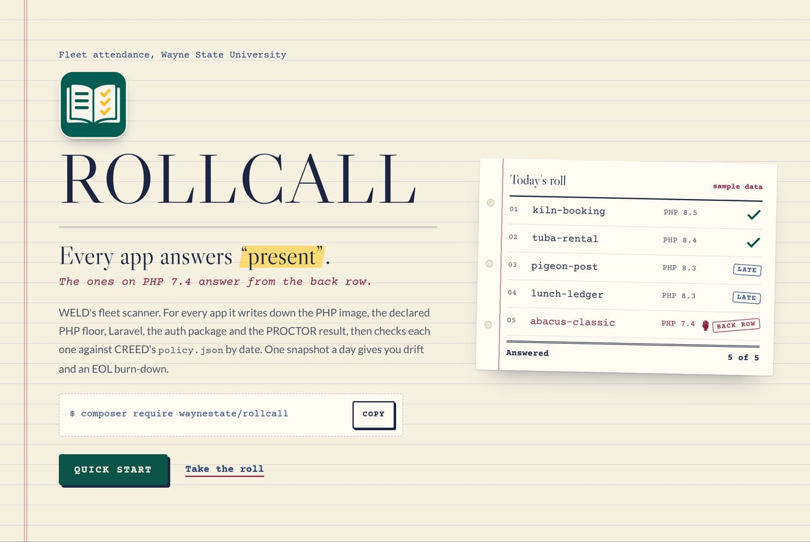
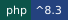
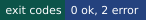
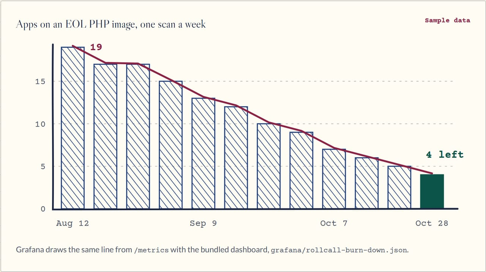
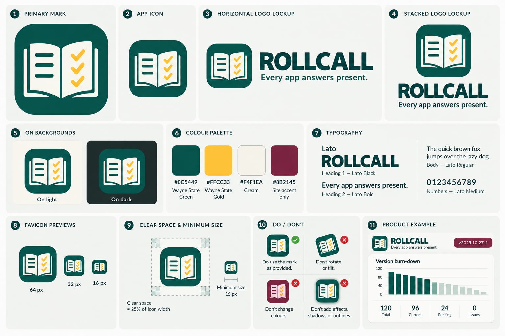

<div align="center">
  <a href="site/index.html"></a>
</div>

# ROLLCALL

<p>
  
  
  
  <a href="https://github.com/waynestate/rollcall/actions/workflows/ci.yml"></a>
</p>

Checks: `composer ci` (the same command runs on GitLab and GitHub).

> Every app answers "present". The ones on PHP 7.4 answer from the back row.

Front page: [`site/index.html`](site/index.html) (static, no build step; see `site/README.md`).

ROLLCALL is the fleet scanner. For every app it answers one question: what is it running, and where does that stand
against the policy? It reports the PHP image, the declared PHP floor, the Laravel version, the auth package and its
version, and the PROCTOR result, then checks each version against CREED's `policy.json` by date. It keeps one snapshot
per scan, so it can show drift and an EOL burn-down over time.

ROLLCALL enforces nothing. It never opens an issue, comments, or deploys, and it exits `0` however the fleet looks.
The public report is counts and progress only: no app names, no owners, no ranking. The per-app list is internal.
(Like a good attendance sheet, it is for noticing who is missing, not for shaming them.)

<div align="center">
  
  <br><sub>One page of the roll book, called name by name. Sample data: the apps are fictional, and a real scan's per-app list stays internal.</sub>
</div>

## Where it sits in WELD

WELD is Wayne State's application stack. ROLLCALL is the roll book for the whole party:

| Part | Job |
|---|---|
| WayneUI (project 0) | The interface layer: tokens, components, four consumer paths |
| CREED | The standards and `policy.json`, the dates ROLLCALL reads |
| PROCTOR | Measures one app against the policy; ROLLCALL reads its JSON report and never re-runs a rule |
| PREFLIGHT | CI templates |
| SESAME | Protocol-neutral auth; ROLLCALL reports which auth package each app uses |
| HELMET | Baseline runtime and its own optional `/metrics` |
| Pinstripe | The coding standard behind this repo's Pint and PHPStan settings |
| Sourdough | Starters |
| ROLLCALL | The fleet census and EOL burn-down |

## How it is built

A framework-free core (`src/`) plus thin entry points that hold no rules:

- `bin/rollcall`: the CLI (`scan`, `report`, `drift`). One PHP command, so it works the same on Windows, macOS and Linux.
- `public/index.php`: a raw-PHP front controller for `GET /metrics` and `GET /report.json`.
- `src/Laravel/`: a Laravel adapter with a dashboard page, a `/metrics` route and `php artisan rollcall:scan`.

Data comes in through three interfaces, each with a fixture adapter, so nothing here needs a live host to try:

| Source | Interface | 0.1 adapters |
|---|---|---|
| Repositories (`composer.json`, `composer.lock`) | `RepositorySource` | a directory of fixtures; GitLab over PSR-18, tested against recorded responses |
| Runtime image per app | `ImageSource` | a JSON export of the app list |
| PROCTOR result | `ProctorReportSource` | a directory of PROCTOR `--format=json` reports |

Everything is read-only toward every source. The only thing ROLLCALL writes is its own snapshot directory.

## Install

```
composer require waynestate/rollcall
```

Until the package is on Packagist, add the repository first (`composer config repositories.rollcall vcs <url>`).
Requires PHP `^8.3`. The CLI is `vendor/bin/rollcall`.

## Quick start

From a checkout, with the bundled fixtures (no network, no token). Install dependencies once with
`composer install` (or the Docker line under "Run the checks").

Linux and macOS (bash):

```
export ROLLCALL_POLICY_FILE=tests/fixtures/policy.json
export ROLLCALL_REPOS_DIR=tests/fixtures/repos
export ROLLCALL_IMAGES_FILE=tests/fixtures/images.json
export ROLLCALL_PROCTOR_DIR=tests/fixtures/proctor
export ROLLCALL_STORE_DIR=var/snapshots
php bin/rollcall scan
php bin/rollcall report
```

Windows (PowerShell, no bash or WSL needed):

```
$env:ROLLCALL_POLICY_FILE = "tests/fixtures/policy.json"
$env:ROLLCALL_REPOS_DIR = "tests/fixtures/repos"
$env:ROLLCALL_IMAGES_FILE = "tests/fixtures/images.json"
$env:ROLLCALL_PROCTOR_DIR = "tests/fixtures/proctor"
$env:ROLLCALL_STORE_DIR = "var/snapshots"
php bin/rollcall scan
php bin/rollcall report
```

`policy.json` is CREED's file; the copy under `tests/fixtures/` is a snapshot for tests. Use the released one in real
runs.

## Commands

```
rollcall scan   [--today=YYYY-MM-DD]
rollcall report [--format=text|json|prometheus] [--internal] [--today=YYYY-MM-DD]
rollcall drift  --feed=<file> [--component=php] [--today=YYYY-MM-DD]
```

- `scan` calls the roll once and stores `<ROLLCALL_STORE_DIR>/<date>.json`. Scanning twice in a day replaces that
  day's snapshot. A gap in one source (a missing report, a bad image tag) becomes a note on that app, not a failed
  scan. A refused GitLab token stops the scan loudly instead of producing a flattering partial answer.
- `report` prints the latest snapshot against the policy as of today. `text` is a terminal table, `json` is the
  machine-readable form, `prometheus` is the metrics text (refused unless `ROLLCALL_METRICS_ENABLED=true`).
  `--internal` adds the per-app list; keep that output inside the project.
- `drift` compares `policy.json` with a saved endoflife.date v1 product page (for example
  `https://endoflife.date/api/v1/products/php/` saved to a file). A difference is a flag for a person to look at; the
  policy stays the source of truth. ROLLCALL does not fetch that page itself.

Exit codes: `0` ok, `2` tool error (bad option, unreadable policy, a source that refused). There is no `1`: ROLLCALL
does not gate anything.

## What the report says

- **PHP image, declared PHP floor, Laravel**: apps per version, the state from the policy (`active`, `security_only`,
  `eol`, `unknown`), the date security support ends and the days left (negative once past).
- **Auth package and PROCTOR**: apps per auth package, and per PROCTOR result (`pass`, `fail`, `none`).
- **Drift**, counted per kind: `image_eol`, `image_unknown`, `image_below_floor`, `floor_allows_eol`,
  `floor_unbounded`, `eol_past_grace` (past the policy's grace days), `laravel_eol`, `proctor_missing`,
  `proctor_failing`, `override_expired`.
- **Progress**: apps that moved since the previous scan and apps that went from an EOL image to a supported one. In
  the internal view each upgraded app carries the day it landed.
- **EOL burn-down**: for each scan day, how many apps ran an EOL image on that day.

State is never decided in code: it is derived from the dates in `policy.json`. A version older than anything the
policy lists counts as EOL; a version newer than the policy knows is `unknown`.

## Configuration

Every setting is an environment variable. `.env.example` holds placeholders; never commit a real token.

| Variable | Meaning | Default |
|---|---|---|
| `ROLLCALL_POLICY_FILE` | Path to CREED's `policy.json` | none (required for `report`, `drift`) |
| `ROLLCALL_STORE_DIR` | Snapshot directory, the only place ROLLCALL writes | `var/snapshots` |
| `ROLLCALL_SOURCE` | `directory` (fixtures) or `gitlab` | `directory` |
| `ROLLCALL_REPOS_DIR` | Fixture repositories as `<group>/<project>/composer.{json,lock}` | none |
| `ROLLCALL_GITLAB_URL` | `https://` base URL of the GitLab instance | none |
| `ROLLCALL_GITLAB_TOKEN` | A `read_api` token on a group or service account (never `api`). Never logged, never printed | none |
| `ROLLCALL_GITLAB_GROUPS` | Comma-separated group ids or paths; subgroups are included | none |
| `ROLLCALL_IMAGES_FILE` | Export of the app list: `{"apps": [{"project": "group/project", "image": "php:8.4-apache"}]}` | none |
| `ROLLCALL_PROCTOR_DIR` | PROCTOR JSON reports, one per app: `group/project` is read from `group__project.json` | none |
| `ROLLCALL_AUTH_PACKAGES` | Comma-separated Composer packages that count as an auth package | the built-in list |
| `ROLLCALL_METRICS_ENABLED` | Turn metrics on (`CLI report --format=prometheus` and `/metrics`) | `false` |
| `ROLLCALL_METRICS_TOKEN` | Bearer token a scraper must present | none |
| `ROLLCALL_METRICS_ALLOW` | Comma-separated scraper IP addresses (exact match) | none |
| `ROLLCALL_PUBLIC_REPORT_ENABLED` | Serve `GET /report.json` (public counts only) | `false` |
| `ROLLCALL_DASHBOARD_ENABLED` | Laravel: serve the dashboard page | `false` |
| `ROLLCALL_DASHBOARD_PATH` | Laravel: dashboard URL path | `rollcall` |
| `ROLLCALL_INTERNAL_ENABLED` | Laravel: serve the per-app page at `<path>/apps` (needs your sign-in middleware) | `false` |
| `ROLLCALL_WAYNEUI_CSS` | Laravel: `https://` or absolute URL of WayneUI's stylesheet for the dashboard | none |

Scanning GitLab (once a person gives you a token and a group): set `ROLLCALL_SOURCE=gitlab` and the three GitLab
variables. ROLLCALL sends only `GET` and `HEAD`, fetches the two Composer files without cloning, skips a file whose blob
id has not changed, follows `Link` pagination only to the configured host, and waits out `429 Retry-After`.

## Metrics

Off by default (the stack's metrics rule). With `ROLLCALL_METRICS_ENABLED=true`, `/metrics` serves Prometheus text built from the latest
snapshot (a request never triggers a scan). It needs `ROLLCALL_METRICS_TOKEN` as a bearer token or an address in
`ROLLCALL_METRICS_ALLOW`; with neither set, nobody gets in. Labels are version numbers, state names, drift kinds and
public package names: no app names or personal data. The dashboard JSON is in `grafana/rollcall-burn-down.json`; import
it into Grafana once a Prometheus server scrapes the endpoint. Run `rollcall scan`
on a schedule so the series moves.

## Laravel

The package registers itself (`extra.laravel.providers`). Publish the config with
`php artisan vendor:publish --tag=rollcall-config`, set the variables above, and schedule `rollcall:scan`. The
dashboard shows counts and progress; the per-app page is a second route that stays off until you enable it, and it
runs behind `rollcall.dashboard.internal_middleware` (default `web` and `auth.sesame`), so an app with no such
middleware fails closed. The page uses WayneUI's class names and takes its stylesheet from `ROLLCALL_WAYNEUI_CSS`.
The `/metrics` route is registered on its own path; if your app already serves `/metrics` (HELMET does), run ROLLCALL's
on a separate app or leave metrics off.

## Run the checks

`composer ci` is the contract: manifest, tests, Pint, PHPStan and `composer audit`. PHP is not needed on the host:

```
docker run --rm -v "${PWD}:/app" -w /app composer:2.10.3 sh -c "composer install --no-interaction && composer ci"
```

(On Windows PowerShell `${PWD}` works as written; in Git Bash use `$(pwd -W)` and set `MSYS_NO_PATHCONV=1`.)

The GitLab pipeline (`.gitlab-ci.yml`) and the GitHub workflow (`.github/workflows/ci.yml`) both wrap `composer ci`,
on PHP 8.3, 8.4 and 8.5. git.wayne.edu has no runners yet; an instance runner there is strongly recommended so this
check can run beside the code it protects.

## Security notes

- Read-only toward GitLab and everything else: one gate in the GitLab adapter allows only `GET` and `HEAD`, and a test
  fails if a write verb appears in `src/`.
- The GitLab token comes from the environment, is sent only to the configured `https` host, and is hidden from debug
  output and error messages. Use a `read_api` token with an expiry and a named rotation owner.
- Composer files are parsed as data. No `composer install`, script or plugin from a scanned repository ever runs.
- PROCTOR reports, image tags and app ids are outside input: shapes are validated, text is bounded, and terminal output
  strips control characters.

<details>
<summary>Watch the back row empty (the burn-down, sample data)</summary>

<br>



<sub>The same line Grafana draws from <code>/metrics</code>. Made-up apps, real arithmetic.</sub>

</details>

<details>
<summary>The brand board (the cover of the book)</summary>

<br>



</details>

## Contributing

This repository is published from Wayne State University's internal GitLab and mirrored to GitHub. Changes land there
first; Wayne State developers open issues and merge requests on the internal project.

Licence: MIT, Copyright Wayne State University.

<div align="center"><b>The whole class</b><br><sub>WayneUI and the stack. Everyone is here today; the ones in the back row know who they are.</sub></div>

<div align="center">
  <a href="https://github.com/waynestate/wayne-ui" title="WayneUI"></a>
  <a href="https://github.com/waynestate/creed" title="CREED"></a>
  <a href="https://github.com/waynestate/proctor" title="PROCTOR"></a>
  <a href="https://github.com/waynestate/sesame" title="SESAME"></a>
  <a href="https://github.com/waynestate/helmet" title="HELMET"></a>
  <a href="https://github.com/waynestate/sourdough" title="Sourdough"></a>
  <a href="https://github.com/waynestate/squire" title="SQUIRE"></a>
  <a href="https://github.com/waynestate/preflight" title="PREFLIGHT"></a>
  <a href="https://github.com/waynestate/pinstripe" title="Pinstripe"></a>
  <a href="https://github.com/waynestate/booster" title="BOOSTER"></a>
  <a href="https://github.com/waynestate/rollcall" title="ROLLCALL"></a>
  <a href="https://github.com/waynestate/drawbridge" title="DRAWBRIDGE"></a>
  <a href="https://github.com/waynestate/advisor" title="ADVISOR"></a>
  <a href="https://github.com/waynestate/weld" title="WELD"></a>
</div>

<div align="center"><sub>Images are regenerated from the front page by <a href="scripts/readme-art/README.md"><code>scripts/readme-art</code></a>. Present.</sub></div>
