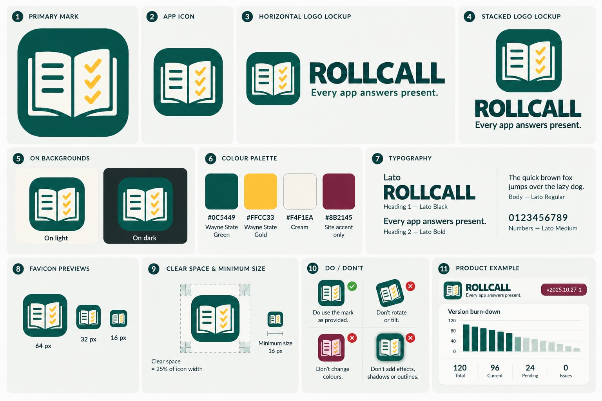

# Rollcall

This page says what Rollcall is and where it sits in the stack. Next: [install it](install.md), then run the [quick start](guides/quick-start.md).

> Every app answers "present". The ones on PHP 7.4 answer from the back row.

Front page: [`site/index.html`](https://github.com/waynestate/rollcall/blob/main/site/index.html). It is static, with no build step (see [`site/README.md`](https://github.com/waynestate/rollcall/blob/main/site/README.md)).
On Citadel, the raw-PHP deploy layer in [`deploy/`](https://github.com/waynestate/rollcall/tree/main/deploy) serves it: a Squire kit whose front controller puts `site/` behind HELMET's security headers. For local development, serve `site/` directly.

Rollcall is the fleet scanner for the Wayne State application stack. For each app it records the PHP image, the
lowest PHP its `composer.json` allows, the Laravel version, the auth package and its version, and the PROCTOR
result. Then it looks up each version by date in CREED's `policy.json`. It keeps one snapshot per scan, so you can
see drift and an EOL burn-down over time. It prunes old snapshots after the retention window (default 90 days; the
newest one always stays).

Rollcall enforces nothing. It never opens an issue, leaves a comment or deploys anything, and it exits `0` whatever
the fleet looks like. The public report has totals only: counts and progress, no app names, owners or rankings. The
per-app list is internal. Like a good attendance sheet, it is for noticing who is missing, not for shaming them.

<div align="center">
  
  <br><sub>One page of the roll book, called name by name. Sample data: the apps are fictional, and a real scan's per-app list stays internal.</sub>
</div>

## Where it sits in the stack

The parts of the Wayne State application stack, and their jobs. WELD is the Laravel starter app that has most of them installed:

| Part | Job |
|---|---|
| WayneUI (project 0) | The interface layer: tokens, components, four consumer paths |
| CREED | The standards and `policy.json`, the dates Rollcall reads |
| PROCTOR | Measures one app against the policy; Rollcall reads its JSON report and never re-runs a rule |
| Preflight | CI templates |
| SESAME | Protocol-neutral auth; Rollcall reports which auth package each app uses |
| HELMET | Baseline runtime and its own optional `/metrics` |
| Pinstripe | The coding standard this repo includes for its Pint and PHPStan settings |
| Sourdough | Starters |
| Rollcall | The fleet census and EOL burn-down |

<div align="center"><b>The whole class</b><br><sub>WayneUI and the stack. Everyone is here today; the ones in the back row know who they are.</sub></div>

<div align="center">
  <a href="https://github.com/waynestate/wayne-ui" title="WayneUI"></a>
  <a href="https://github.com/waynestate/creed" title="CREED"></a>
  <a href="https://github.com/waynestate/proctor" title="PROCTOR"></a>
  <a href="https://github.com/waynestate/sesame" title="SESAME"></a>
  <a href="https://github.com/waynestate/helmet" title="HELMET"></a>
  <a href="https://github.com/waynestate/sourdough" title="Sourdough"></a>
  <a href="https://github.com/waynestate/squire" title="Squire"></a>
  <a href="https://github.com/waynestate/preflight" title="Preflight"></a>
  <a href="https://github.com/waynestate/pinstripe" title="Pinstripe"></a>
  <a href="https://github.com/waynestate/booster" title="Booster"></a>
  <a href="https://github.com/waynestate/rollcall" title="Rollcall"></a>
  <a href="https://git.wayne.edu/enterprise-apps/drawbridge" title="Drawbridge"></a>
  <a href="https://github.com/waynestate/advisor" title="ADVISOR"></a>
  <a href="https://github.com/waynestate/weld" title="WELD"></a>
</div>

<div align="center"><sub>Images are regenerated from the front page by <a href="https://github.com/waynestate/rollcall/tree/main/scripts/readme-art"><code>scripts/readme-art</code></a>. Present.</sub></div>

<details>
<summary>The brand board (the cover of the book)</summary>

<br>



</details>

## Install

One line:

```
composer require waynestate/rollcall
```

The first command is `php bin/rollcall scan`; the [quick start](guides/quick-start.md) runs it on the fixtures in the repo, and [Install](install.md) has the rest.
